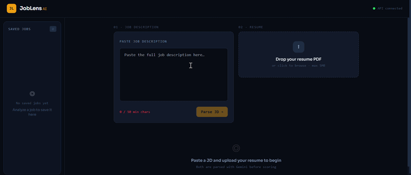
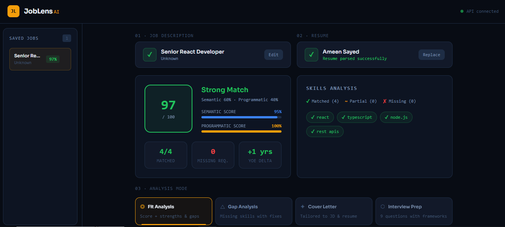
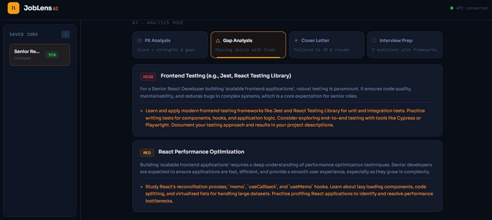
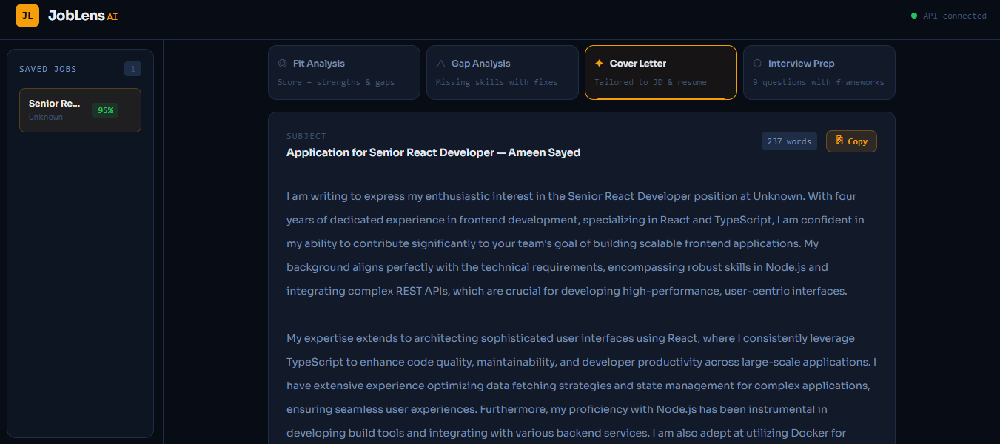
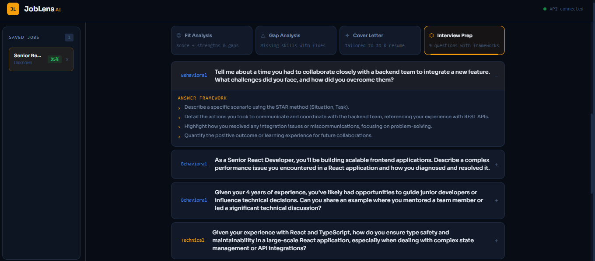

# ◎ JobLens AI

> **Know your fit before you apply.**

A structured job-fit intelligence tool built with the MERN stack, TypeScript, and Google Gemini AI. JobLens goes beyond keyword matching — it parses both your resume and the job description into structured JSON, scores the match using a hybrid semantic + programmatic engine, and delivers four AI-powered analysis modes, plus resume tailoring and mock interview previews.

---

## ✦ Features

### Hybrid Scoring Engine
- **Programmatic score (40%)** — whole-word skill comparison with alias matching (e.g. `node` → `node.js`, `aws` → `amazon web services`), so `go` never matches `mongodb`
- **Semantic score (60%)** — vector embeddings via `gemini-embedding-001` + cosine similarity to catch conceptual matches keyword search misses
- Single weighted final score (0–100) with a full breakdown

### Evidence-Backed Results
- **Quoted proof** — each matched skill is linked to the resume line that shows it
- **Quote verification** — Gemini cites the lines, but the backend confirms each one against text extracted from the PDF itself. A quote that can't be found is never shown
- **Demonstrated vs. listed** — skills used in work or a project are separated from skills that are only named
- **Requirement checks** — rule-based results for experience, seniority, location, visa and education, which can also report that the resume doesn't say

### Four AI Analysis Modes
| Mode | Output |
|------|--------|
| **Fit Analysis** | Score card + 3 strengths + 3 gaps + one-line verdict |
| **Gap Analysis** | Prioritized missing skills with specific actionable fixes |
| **Cover Letter** | Tailored letter citing your actual projects and experience |
| **Interview Prep** | 9 questions (behavioral / technical / role-specific) with resume-specific answer frameworks |

### Previews
**Resume Tailoring** and **Mock Interview** (with optional voice input) run in the browser on rule-based logic until their backend exists. They are labelled as previews in the app.

### Smart Parsing Pipeline
- JD text → Gemini 2.5 Flash → structured JSON (required skills, nice-to-have, YOE, tools, culture signals, responsibilities)
- PDF resume → sent directly to Gemini 2.5 Flash → structured JSON (skills, tools, work history, projects, education)
- Output is constrained with `responseSchema`, validated with Zod, and retried if a request fails or the response is invalid
- Both stored in MongoDB with their embeddings. Parsing the same job description again reuses the stored result

### Saved Jobs, History and Settings
- Every analyzed job saved automatically with its score badge
- Switch between saved jobs with no re-parsing
- Up to 20 jobs kept in this browser, searchable on the History page
- Theme, display name and default results tab on the Settings page

---

## 🎬 Demo & Screenshots



### Score Card & Skill Grid


### Gap Analysis


### Cover Letter Mode


### Interview Prep


## ⬡ Tech Stack

### Backend
| Layer | Technology |
|-------|-----------|
| Runtime | Node.js + TypeScript |
| Framework | Express.js |
| Database | MongoDB Atlas |
| AI Model | Google Gemini 2.5 Flash (also reads the PDF) |
| Embeddings | gemini-embedding-001 |
| PDF Text | unpdf (independent text used to verify quotes) |
| Validation | Zod |
| File Upload | Multer |
| Tests | Vitest |

### Frontend
| Layer | Technology |
|-------|-----------|
| Framework | React 18 + TypeScript |
| Build Tool | Vite |
| Styling | Tailwind CSS |
| HTTP Client | Axios |
| Routing | React Router v7 |
| Font | Plus Jakarta Sans |

---

## ◎ Project Structure

```
joblens-ai/
├── backend/
│   ├── src/
│   │   ├── config/
│   │   │   ├── database.ts        # MongoDB connection
│   │   │   └── gemini.ts          # Gemini structured output + embeddings
│   │   ├── models/
│   │   │   ├── Job.ts             # Job schema (raw + parsed JSON + embedding)
│   │   │   └── Resume.ts          # Resume schema (PDF text + parsed JSON + embedding)
│   │   ├── services/
│   │   │   ├── jdParser.ts        # JD text → Gemini → structured JSON, deduplicated
│   │   │   ├── resumeParser.ts    # PDF → Gemini → structured JSON
│   │   │   ├── evidence.ts        # Verifies quotes against the PDF text and grades them
│   │   │   ├── hardChecks.ts      # Experience, seniority, location, visa, education rules
│   │   │   ├── scorer.ts          # Hybrid scoring engine (cosine + programmatic)
│   │   │   └── modePrompts.ts     # 4 mode-specific Gemini prompts
│   │   ├── routes/
│   │   │   ├── jobs.ts            # POST /api/jobs/parse, GET /api/jobs/:id
│   │   │   ├── resumes.ts         # POST /api/resumes/parse, GET /api/resumes/:id
│   │   │   └── analyze.ts         # POST /api/analyze, POST /api/analyze/score-only
│   │   ├── middleware/
│   │   │   ├── upload.ts          # Multer PDF config (5MB, memory storage)
│   │   │   └── errorHandler.ts    # Global error handler + asyncHandler wrapper
│   │   ├── utils/                 # Retries, structured output, Zod → Gemini schema, PDF text
│   │   ├── types/index.ts         # All shared TypeScript interfaces
│   │   ├── app.ts                 # Express app setup + CORS + routes
│   │   └── server.ts              # Entry point — DB + Gemini init + listen
│   ├── tests/                     # Vitest unit tests
│   ├── package.json
│   ├── tsconfig.json
│   └── .env.example
│
└── frontend/
    ├── src/
    │   ├── api/
    │   │   ├── client.ts          # Axios instance
    │   │   ├── jobs.ts            # parseJD, getJob
    │   │   ├── resumes.ts         # parseResume (multipart), getResume
    │   │   ├── analyze.ts         # analyze (4 modes), scoreOnly
    │   │   └── preview.ts         # Browser stand-ins for tailoring and mock interview
    │   ├── components/ui/
    │   │   ├── ScoreCard.tsx      # Score circle + semantic/programmatic bars
    │   │   ├── SkillGrid.tsx      # Matched / partial / missing pills + skill evidence
    │   │   ├── HardChecks.tsx     # Requirement check results
    │   │   ├── ModeTabs.tsx       # 6-tab switcher
    │   │   ├── ModeResults.tsx    # FitResult, GapResult, CoverLetterResult, InterviewResult
    │   │   ├── ResumeTailoring.tsx # Tailoring preview
    │   │   ├── MockInterview.tsx  # Mock interview preview with voice input
    │   │   ├── JDInput.tsx        # Textarea → collapses to badge on parse
    │   │   ├── ResumeUpload.tsx   # Drag-and-drop PDF zone
    │   │   └── JobSidebar.tsx     # Navigation + saved jobs with score badges
    │   ├── hooks/useSettings.ts   # Settings stored in the browser
    │   ├── pages/
    │   │   ├── Analyze.tsx        # Main page — full analysis flow
    │   │   ├── History.tsx        # Searchable list of past analyses
    │   │   └── Settings.tsx       # Theme, name and default tab
    │   ├── types/index.ts         # Frontend TypeScript types
    │   └── index.css              # CSS variables + animations
    ├── package.json
    ├── tsconfig.json
    ├── vite.config.ts
    ├── tailwind.config.js
    ├── postcss.config.js
    └── .env.example
```

---

## ▶ Quick Start

### Prerequisites
- Node.js 18+
- MongoDB Atlas account (free tier works)
- Google Gemini API key — [get one here](https://aistudio.google.com/app/apikey)

### 1. Clone the repo

```bash
git clone https://github.com/Ameen8917/Joblens-AI.git
cd Joblens-AI
```

### 2. Setup Backend

```bash
cd backend
cp .env.example .env
```

Fill in your `.env`:

```env
PORT=5000
NODE_ENV=development
MONGODB_URI=mongodb+srv://<username>:<password>@<cluster>.mongodb.net/joblens?retryWrites=true&w=majority
GEMINI_API_KEY=your_gemini_api_key_here
CLIENT_URL=http://localhost:5173
```

```bash
npm install
npm run dev
```

Backend runs at `http://localhost:5000`

### 3. Setup Frontend

```bash
cd frontend
cp .env.example .env
npm install
npm run dev
```

Frontend runs at `http://localhost:5173`

### 4. Run the tests

```bash
cd backend
npm test
```

---

## ↑ API Reference

### Jobs
| Method | Endpoint | Description |
|--------|----------|-------------|
| `POST` | `/api/jobs/parse` | Parse raw JD text → structured JSON + jobId. Text already parsed returns the existing job |
| `GET` | `/api/jobs/:id` | Retrieve a previously parsed JD |

**Request — POST /api/jobs/parse**
```json
{
  "text": "We are looking for a Senior React Developer..."
}
```

**Response**
```json
{
  "success": true,
  "jobId": "664f1a2b3c4d5e6f7a8b9c0d",
  "parsed": {
    "title": "Senior React Developer",
    "company": "Acme Corp",
    "roleType": "IC",
    "requiredSkills": ["react", "typescript", "node.js"],
    "niceToHaveSkills": ["docker", "aws"],
    "yearsOfExperience": 3,
    "tools": ["jira", "figma"],
    "culturalSignals": ["fast-paced", "remote-first"],
    "responsibilities": ["Build scalable frontend components", "..."]
  }
}
```

### Resumes
| Method | Endpoint | Description |
|--------|----------|-------------|
| `POST` | `/api/resumes/parse` | Upload PDF → structured JSON + resumeId |
| `GET` | `/api/resumes/:id` | Retrieve a previously parsed resume |

**Request — POST /api/resumes/parse**
```
Content-Type: multipart/form-data
Field: resume (PDF file, max 5MB)
```

### Analyze
| Method | Endpoint | Description |
|--------|----------|-------------|
| `POST` | `/api/analyze` | Run a mode (fit / gaps / cover-letter / interview) |
| `POST` | `/api/analyze/score-only` | Get score without running a Gemini mode |

**Request — POST /api/analyze**
```json
{
  "mode": "fit",
  "jobId": "664f1a2b3c4d5e6f7a8b9c0d",
  "resumeId": "664f1a2b3c4d5e6f7a8b9c0e"
}
```

**Modes:** `fit` · `gaps` · `cover-letter` · `interview`

### Health
| Method | Endpoint | Description |
|--------|----------|-------------|
| `GET` | `/health` | Service health check |

---

## ◈ Scoring Logic

```
Final Score = (Semantic Score × 0.60) + (Programmatic Score × 0.40)
```

**Programmatic Score** — compares `jd.requiredSkills[]` against `resume.skills[] + resume.tools[]`
- Exact match, alias match, or a skill that implies the requirement (`postgresql` → `sql`) → full credit
- All of one skill's words appear in the other (`react` and `react native`) → 0.5 credit
- No match → 0 credit
- Score = earned credits / total required skills × 100

**Semantic Score** — cosine similarity between JD and resume embeddings
- Embeddings generated with `gemini-embedding-001`
- Similarity remapped from [-1, 1] to [0, 100]
- Catches conceptual matches that keyword comparison misses

**Score Interpretation**
| Score | Label |
|-------|-------|
| 75–100 | Strong Match |
| 50–74 | Moderate Match |
| 0–49 | Weak Match |

---

## ⚙ Environment Variables

### Backend `.env`
| Variable | Description |
|----------|-------------|
| `PORT` | Server port (default: 5000) |
| `NODE_ENV` | `development` or `production` |
| `MONGODB_URI` | MongoDB Atlas connection string |
| `GEMINI_API_KEY` | Google Gemini API key |
| `CLIENT_URL` | Frontend URL for CORS (default: http://localhost:5173) |

### Frontend `.env`
| Variable | Description |
|----------|-------------|
| `VITE_API_URL` | Backend URL (default: http://localhost:5000) |

---

## ⚠ Known Limitations

- **Gemini rate limits** — the free tier has request limits. Requests are retried, but heavy use can still fail
- **No auth** — there are no user accounts, so anyone with a resume ID can read that stored resume. Saved jobs live in browser localStorage
- **Semantic score runs high** — similarity is remapped from [-1, 1], and real embeddings rarely score near the bottom of that range. Recalibrating it is on the roadmap
- **Resume Tailoring and Mock Interview** are rule-based previews, not yet AI-backed
- **Quote verification needs a text layer** — scanned PDFs can still be parsed, but their quotes can't be confirmed. Multi-column layouts can also cause real lines to go unconfirmed

---

## ✦ Roadmap

- [ ] Quality test suite with expected results, and a recalibrated semantic score
- [ ] AI-backed resume tailoring with accept and reject controls
- [ ] Live mock interview with streamed follow-up questions
- [ ] Live demo, CI and a one-command Docker setup

---

## △ Author

**Ameen** — Senior Full-Stack & AI Engineer

Built with React · Express · MongoDB Atlas · Google Gemini AI · TypeScript

---

## ✦ License

MIT — see [LICENSE](./LICENSE).