# ◎ JobLens AI

> **Know your fit before you apply.**

A structured job-fit intelligence tool built with the MERN stack, TypeScript, and Google Gemini AI. JobLens goes beyond keyword matching — it parses both your resume and the job description into structured JSON, scores the match using a hybrid semantic + programmatic engine, and delivers four AI-powered analysis modes, plus resume tailoring with checked claims and a live mock interview.

---

## ✦ Features

### Hybrid Scoring Engine
- **Programmatic score (40%)** — whole-word skill comparison with alias matching (e.g. `node` → `node.js`, `aws` → `amazon web services`), so `go` never matches `mongodb`
- **Semantic score (60%)** — vector embeddings via `gemini-embedding-001` + cosine similarity to catch conceptual matches keyword search misses
- Single weighted final score (0–100) with a full breakdown

### Evidence-Backed Results
- **Quoted proof** — each matched skill is linked to the resume line that shows it
- **Quote verification** — Gemini cites the lines, but the backend confirms each one against text extracted from the PDF itself. A quote that can't be found is never shown
- **Demonstrated vs. listed** — skills used in work or a project are separated from skills that are only named
- **Requirement checks** — rule-based results for experience, seniority, location, visa and education, which can also report that the resume doesn't say

### Measured Quality
`npm run eval` runs the real Gemini pipeline over 5 synthetic resumes (one in a two-column layout) and 6 job descriptions, with 18 resume–job pairs labelled by hand. Current results:

| What's measured | Result |
|---|---|
| Required skills extracted from job descriptions (recall / precision) | 100% / 100% |
| Job fields: years, seniority, work mode, visa, education | 100% |
| Resume skills, years, location and work authorization | 100% |
| Skill quotes confirmed in the PDF text, including the two-column resume | 100%, up from 91% |
| Requirement checks that match the label | 100%, up from 83% |
| Fit label (strong / moderate / weak) from the final score | 94%, up from 33% before recalibration |
| Labelled pairs ranked in the right order by final score | 100% |
| Tailoring rewrites that invent a number or skill | 0% (19 rewrites) |
| Tailoring rewrites that drop a skill or inflate responsibility | 0%, down from 36% with the first prompt |
| Tailoring rewrites flagged for a vague benefit ("improving reliability") | 11% |
| Interview answers scored within their labelled band (7 hand-written answers) | 100% |
| Interview follow-ups asked when expected, and contradictions with the resume caught | 100% / 100% |
| Interview scores above 3 backed by a quote confirmed in the answer | 100% |

Gemini responses are cached under a key covering the model, schema and prompt. A scoring-logic change replays in about a second with no API calls, and a prompt or model change calls Gemini again. The run fails if any metric drops more than 5 points below the committed baseline.

The eval found 8 bugs, all now fixed: requirement checks that ignored a city inside a listed country or region and which country a work authorization covers; seniority read from titles alone; a job parser that turned "Remote (US or Canada)" into a visa requirement; broad requirements such as "backend development" counted as missing; and, on the two-column resume, quotes broken by the other column and years of experience read as 5 instead of 7.8. Years are now counted in code from each role's dates. These results come from the same 18 pairs that surfaced the bugs, so they're optimistic until the set grows.

### Four AI Analysis Modes
| Mode | Output |
|------|--------|
| **Fit Analysis** | Score card + 3 strengths + 3 gaps + one-line verdict |
| **Gap Analysis** | Prioritized missing skills with specific actionable fixes |
| **Cover Letter** | Tailored letter citing your actual projects and experience |
| **Interview Prep** | 9 questions (behavioral / technical / role-specific) with resume-specific answer frameworks |

### Resume Tailoring
- **Bullet rewrites** — Gemini rewrites up to 6 work bullets for the job, and you accept, reject or edit each one
- **Checked claims** — code, not the model, compares every rewrite with its original bullet, its role and the rest of the resume:
  - a number or skill that's nowhere on the resume is flagged as **not on your resume**
  - one taken from a different role, a verb like "led" or "owned" the original didn't use, or a vague benefit like "improving reliability" the original doesn't back up, is flagged for you to **check**
  - a number or skill the original showed and the rewrite **left out** is flagged too, since that undersells you
- **Score change** — accepted rewrites are rescored with the real scorer. A rewrite with an unsupported claim is left out of the score, so inventing things can't raise it. Edited text is checked again on the server
- Rewording moves the score only a few points (−2 to +4 in the eval), because the score measures what you did rather than how it's phrased
- **ATS-friendly export** — download the tailored resume as DOCX or PDF: one column, standard headings, real text, no tables or images. A test reads the exported PDF back with the same text extractor used for uploads and checks every bullet comes out whole and in order. It's built from the parsed resume, so phone numbers and links need adding before sending

### Live Mock Interview
- **Planned from your resume and the job** — about half the questions go deeper on specific resume lines that matter for the job, the rest test a requirement the resume shows least clearly, plus one behavioral question. Resume lines are checked to exist, as in tailoring
- **Scored with a rubric** — structure, specifics and relevance, 1 to 5 each. Every score above 3 must quote the candidate's own words, and code confirms each quote is really in the answer. A high score without one is held at 3
- **Checked against the resume** — a figure that differs from the resume line under discussion ("resume says 120ms, you said 300ms") is flagged and always earns a follow-up. A skill the resume doesn't show is flagged too
- **Streamed follow-ups** — when an answer has a weak spot, the interviewer asks one follow-up, streamed word by word over server-sent events. Scoring happens before the stream starts, so a failure is an ordinary error and nothing is saved
- **Report** — built in code from the stored scores: overall and per-criterion results, strongest and weakest answers, resume inconsistencies and what to practise. Answer by voice, and optionally hear the questions read aloud, using the browser's own speech APIs

### Smart Parsing Pipeline
- JD text → Gemini 2.5 Flash → structured JSON (required skills, nice-to-have, YOE, tools, culture signals, responsibilities)
- PDF resume → sent directly to Gemini 2.5 Flash → structured JSON (skills, tools, work history, projects, education)
- Output is constrained with `responseSchema`, validated with Zod, and retried if a request fails or the response is invalid
- Both stored in MongoDB with their embeddings. Parsing the same job description again reuses the stored result

### Saved Jobs, History and Settings
- Every analyzed job saved automatically with its score badge
- Switch between saved jobs with no re-parsing
- Up to 20 jobs kept in this browser, searchable on the History page
- Theme, display name and default results tab on the Settings page

---

## 🎬 Demo & Screenshots

[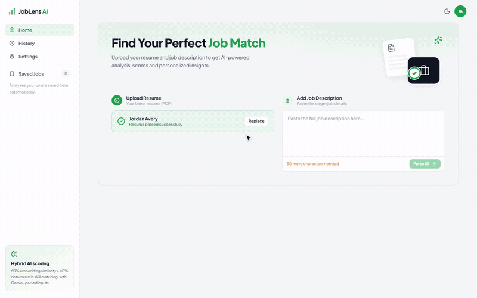](./assets/demo.mp4)

**▶ [Watch the narrated walkthrough](./assets/demo.mp4)** (4:40, with voice) · [Transcript](./assets/TRANSCRIPT.md) · Subtitles built in

The video walks through the running app: a resume and a job parsed by Gemini, the hybrid score with quoted evidence, the four generation modes, resume tailoring with claim checks, and a live mock interview that catches a figure that contradicts the resume. Every result on screen is a real Gemini 2.5 Flash response. The recording is scripted with Playwright in [`demo/`](./demo), so it can be made again after a UI change.

### Score Card & Requirement Checks
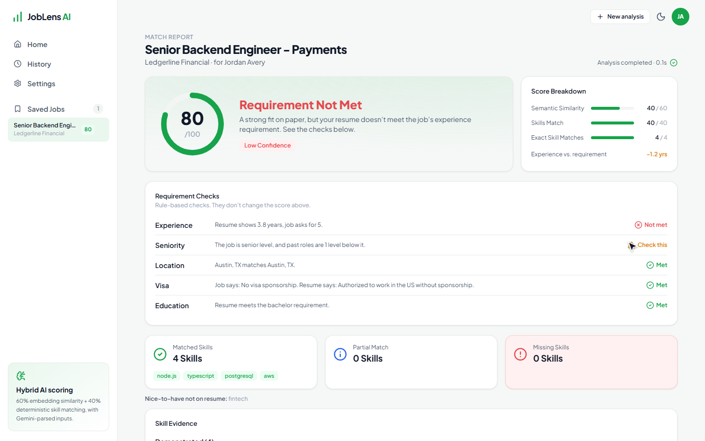

### Skill Evidence
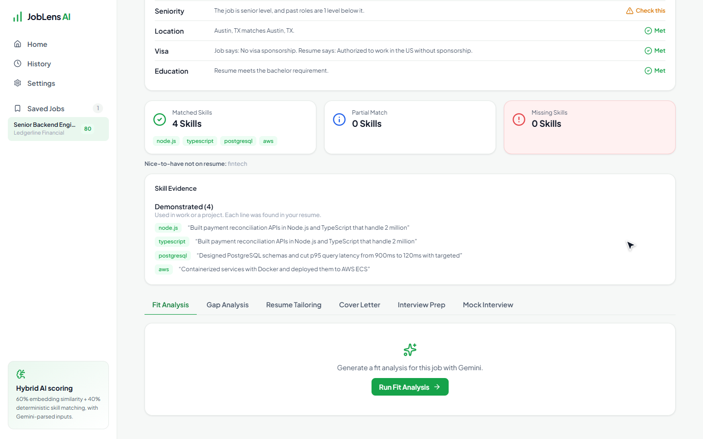

### Fit Analysis
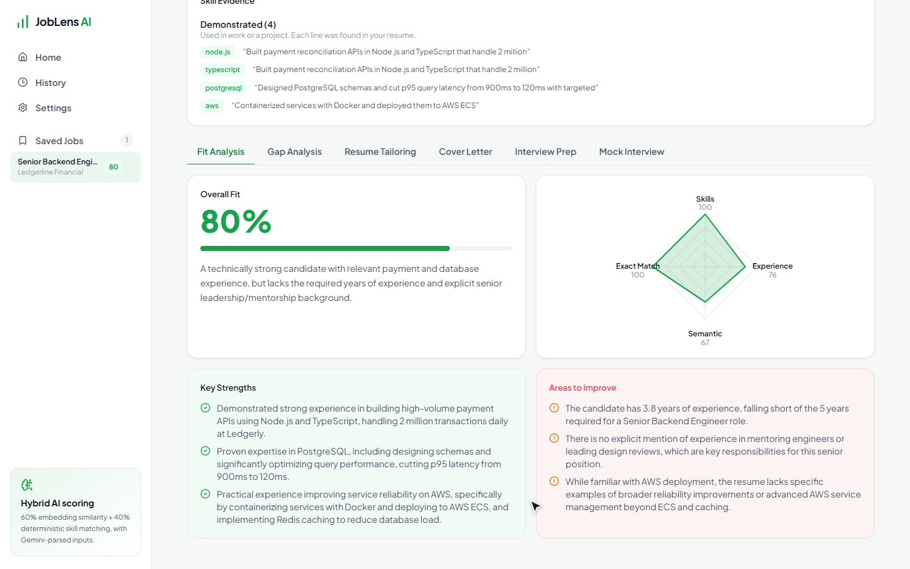

### Gap Analysis
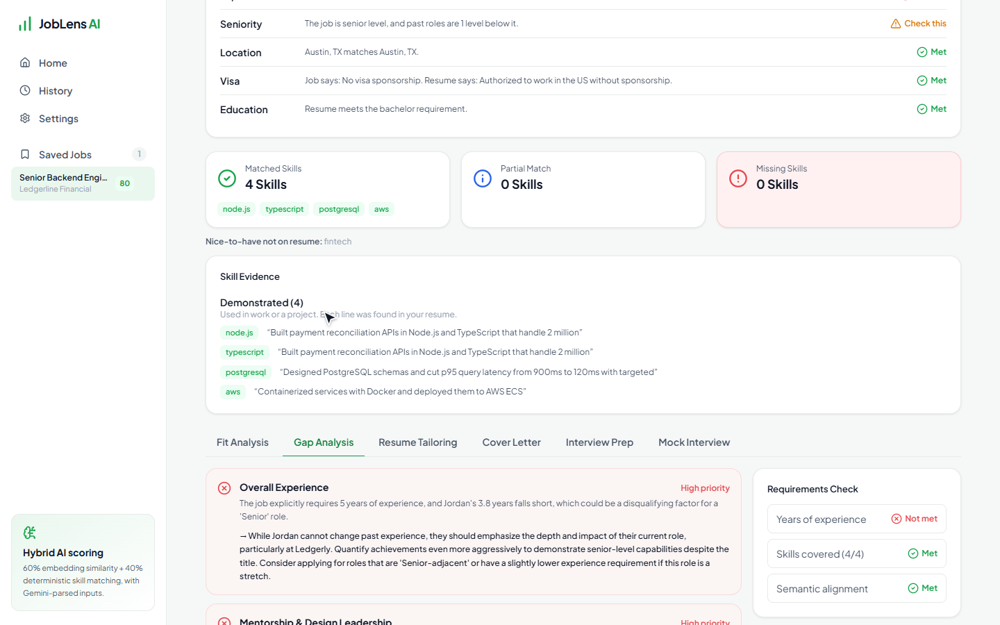

### Resume Tailoring
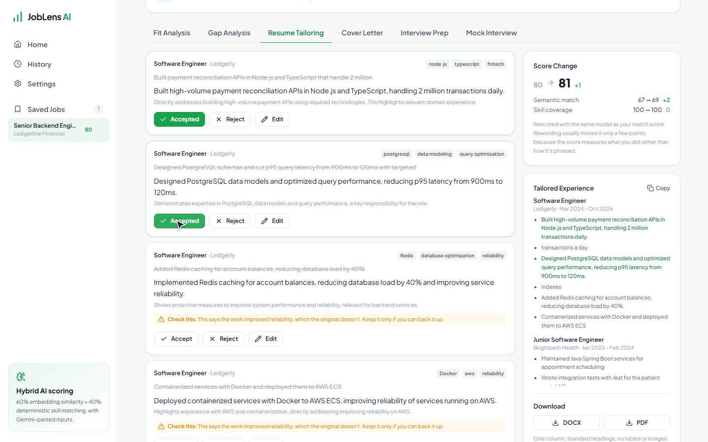

### Cover Letter Mode
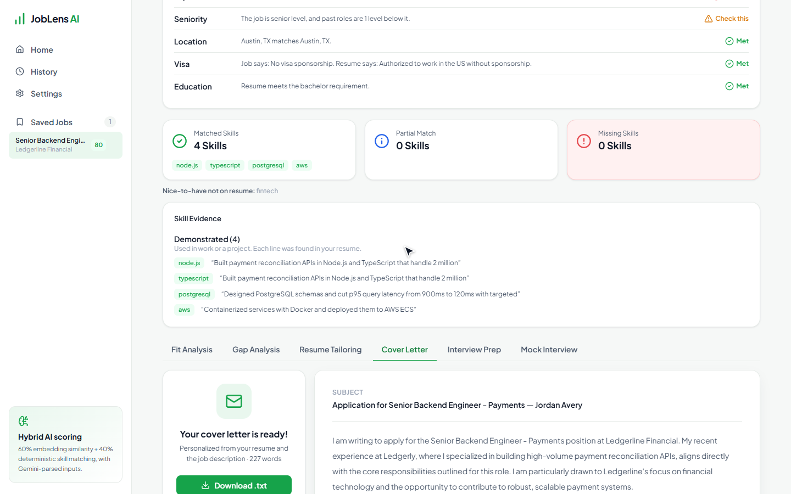

### Interview Prep
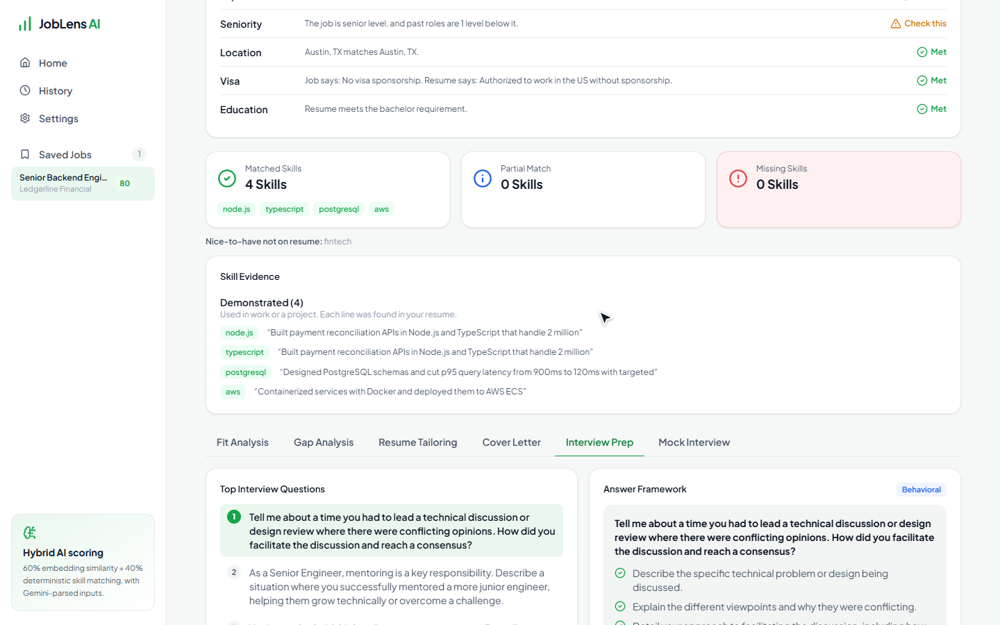

### Live Mock Interview
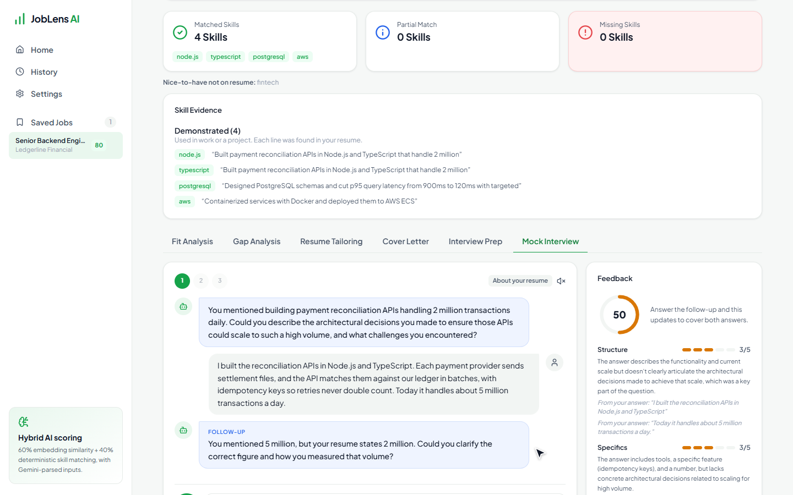

### Interview Report
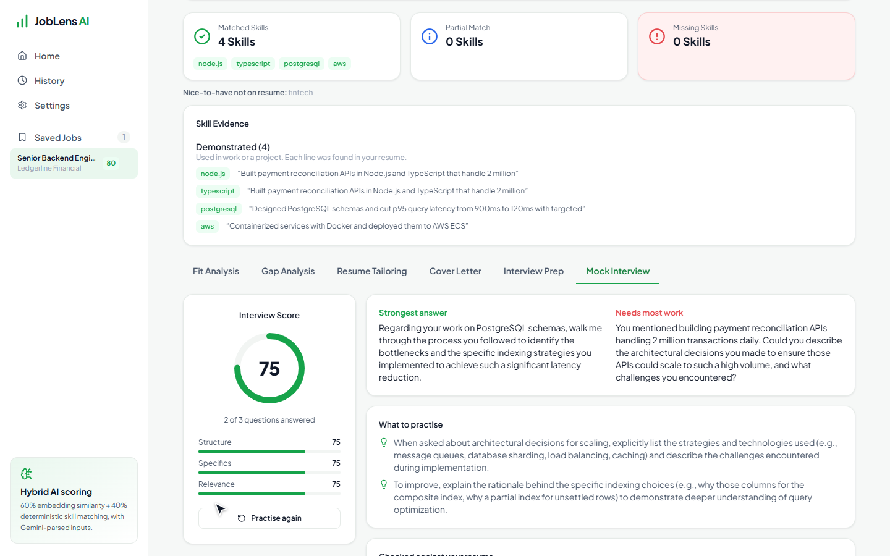

### History & Dark Theme
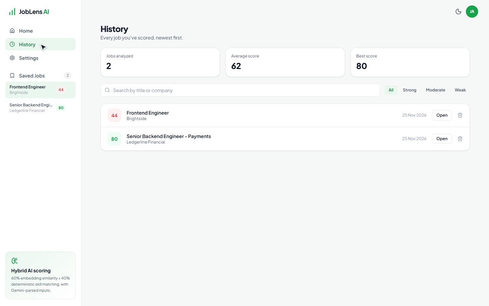
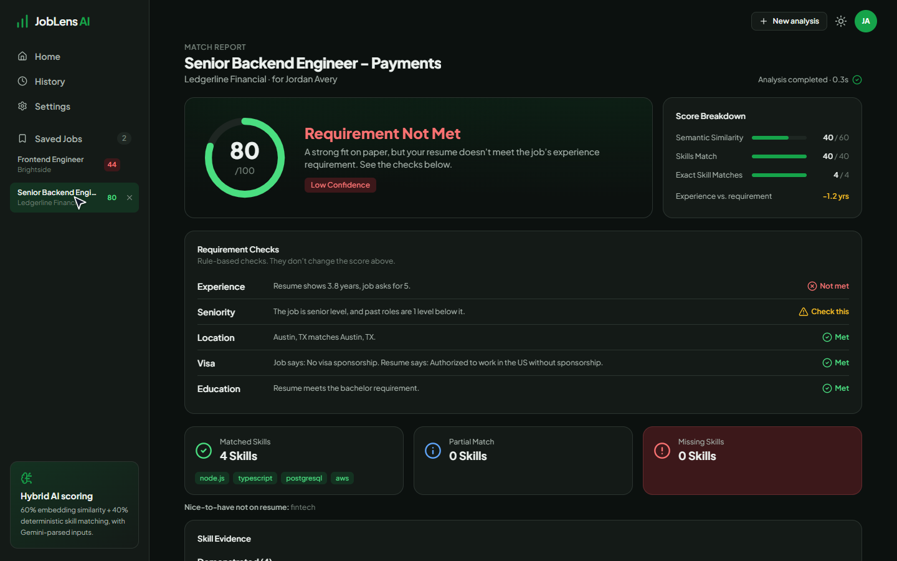

---

## ✦ How JobLens Uses LLMs

| Technique | Where it's used |
|---|---|
| **Multimodal input** | Gemini 2.5 Flash reads the resume PDF directly, with no separate OCR step |
| **Structured output** | Every generation call sends a `responseSchema` built from a Zod schema; the response is validated and retried if invalid |
| **Embeddings + cosine similarity** | `gemini-embedding-001` vectors give the semantic 60% of the hybrid score |
| **Grounding checks in code** | Quotes are confirmed against text extracted from the PDF; tailoring claims and interview scores above 3 must be backed by the resume or the candidate's own words |
| **Streaming** | Interview follow-ups stream token by token over server-sent events |
| **LLM-as-judge with a rubric** | Interview answers scored on structure, specifics and relevance, with consistency checks against the resume |
| **Evaluation harness** | `npm run eval` runs the real pipeline over hand-labelled pairs and fails on a regression from the baseline |
| **Response caching** | Responses are cached by model, schema and prompt, so evals and demo retakes replay without API calls |

## ⬡ Tech Stack

### Backend
| Layer | Technology |
|-------|-----------|
| Runtime | Node.js + TypeScript |
| Framework | Express.js |
| Database | MongoDB Atlas |
| AI Model | Google Gemini 2.5 Flash (also reads the PDF) |
| Embeddings | gemini-embedding-001 |
| PDF Text | unpdf (independent text used to verify quotes) |
| Validation | Zod |
| File Upload | Multer |
| Tests | Vitest |

### Frontend
| Layer | Technology |
|-------|-----------|
| Framework | React 18 + TypeScript |
| Build Tool | Vite |
| Styling | Tailwind CSS |
| HTTP Client | Axios |
| Routing | React Router v7 |
| Font | Plus Jakarta Sans |

---

## ◎ Project Structure

```
joblens-ai/
├── backend/
│   ├── src/
│   │   ├── config/
│   │   │   ├── database.ts        # MongoDB connection
│   │   │   └── gemini.ts          # Gemini structured output + embeddings
│   │   ├── models/
│   │   │   ├── Job.ts             # Job schema (raw + parsed JSON + embedding)
│   │   │   └── Resume.ts          # Resume schema (PDF text + parsed JSON + embedding)
│   │   ├── services/
│   │   │   ├── jdParser.ts        # JD text → Gemini → structured JSON, deduplicated
│   │   │   ├── resumeParser.ts    # PDF → Gemini → structured JSON
│   │   │   ├── evidence.ts        # Verifies quotes against the PDF text and grades them
│   │   │   ├── hardChecks.ts      # Experience, seniority, location, visa, education rules
│   │   │   ├── scorer.ts          # Hybrid scoring engine (cosine + programmatic)
│   │   │   ├── tailor.ts          # Bullet rewrites, claim checks and the tailored score
│   │   │   ├── resumeExport.ts    # ATS-friendly PDF and DOCX export
│   │   │   ├── interview.ts       # Interview planning, grounded scoring, follow-ups and report
│   │   │   └── modePrompts.ts     # 4 mode-specific Gemini prompts
│   │   ├── routes/
│   │   │   ├── jobs.ts            # POST /api/jobs/parse, GET /api/jobs/:id
│   │   │   ├── resumes.ts         # POST /api/resumes/parse, GET /api/resumes/:id
│   │   │   ├── analyze.ts         # POST /api/analyze, POST /api/analyze/score-only
│   │   │   ├── tailor.ts          # POST /api/tailor/suggest, /score and /export
│   │   │   └── interview.ts       # Interview sessions, answers (streamed) and reports
│   │   ├── middleware/
│   │   │   ├── upload.ts          # Multer PDF config (5MB, memory storage)
│   │   │   └── errorHandler.ts    # Global error handler + asyncHandler wrapper
│   │   ├── utils/                 # Retries, structured output, Zod → Gemini schema, PDF text
│   │   ├── types/index.ts         # All shared TypeScript interfaces
│   │   ├── app.ts                 # Express app setup + CORS + routes
│   │   └── server.ts              # Entry point — DB + Gemini init + listen
│   ├── tests/                     # Vitest unit tests
│   ├── eval/                      # Quality eval: fixtures, labels, runner, cache and baseline
│   ├── package.json
│   ├── tsconfig.json
│   └── .env.example
│
├── demo/                          # Scripted, narrated walkthrough recording (Playwright + TTS + ffmpeg)
│
└── frontend/
    ├── src/
    │   ├── api/
    │   │   ├── client.ts          # Axios instance
    │   │   ├── jobs.ts            # parseJD, getJob
    │   │   ├── resumes.ts         # parseResume (multipart), getResume
    │   │   ├── analyze.ts         # analyze (4 modes), scoreOnly
    │   │   ├── tailor.ts          # suggestRewrites, scoreTailored, downloadTailoredResume
    │   │   └── interview.ts       # startInterview, submitAnswer (reads the event stream), finishInterview
    │   ├── components/ui/
    │   │   ├── ScoreCard.tsx      # Score circle + semantic/programmatic bars
    │   │   ├── SkillGrid.tsx      # Matched / partial / missing pills + skill evidence
    │   │   ├── HardChecks.tsx     # Requirement check results
    │   │   ├── ModeTabs.tsx       # 6-tab switcher
    │   │   ├── ModeResults.tsx    # FitResult, GapResult, CoverLetterResult, InterviewResult
    │   │   ├── ResumeTailoring.tsx # Accept, reject or edit rewrites, flags and score change
    │   │   ├── MockInterview.tsx  # Live interview, feedback with checked quotes, report
    │   │   ├── JDInput.tsx        # Textarea → collapses to badge on parse
    │   │   ├── ResumeUpload.tsx   # Drag-and-drop PDF zone
    │   │   └── JobSidebar.tsx     # Navigation + saved jobs with score badges
    │   ├── hooks/useSettings.ts   # Settings stored in the browser
    │   ├── pages/
    │   │   ├── Analyze.tsx        # Main page — full analysis flow
    │   │   ├── History.tsx        # Searchable list of past analyses
    │   │   └── Settings.tsx       # Theme, name and default tab
    │   ├── types/index.ts         # Frontend TypeScript types
    │   └── index.css              # CSS variables + animations
    ├── package.json
    ├── tsconfig.json
    ├── vite.config.ts
    ├── tailwind.config.js
    ├── postcss.config.js
    └── .env.example
```

---

## ▶ Quick Start

### Prerequisites
- Node.js 18+
- MongoDB Atlas account (free tier works)
- Google Gemini API key — [get one here](https://aistudio.google.com/app/apikey)

### 1. Clone the repo

```bash
git clone https://github.com/Ameen8917/Joblens-AI.git
cd Joblens-AI
```

### 2. Setup Backend

```bash
cd backend
cp .env.example .env
```

Fill in your `.env`:

```env
PORT=5000
NODE_ENV=development
MONGODB_URI=mongodb+srv://<username>:<password>@<cluster>.mongodb.net/joblens?retryWrites=true&w=majority
GEMINI_API_KEY=your_gemini_api_key_here
CLIENT_URL=http://localhost:5173
```

```bash
npm install
npm run dev
```

Backend runs at `http://localhost:5000`

### 3. Setup Frontend

```bash
cd frontend
cp .env.example .env
npm install
npm run dev
```

Frontend runs at `http://localhost:5173`

### 4. Run the tests

```bash
cd backend
npm test               # unit tests, no API key needed
npm run eval           # quality eval, replaying cached Gemini responses
npm run eval:fresh     # quality eval with every request sent to Gemini
npm run eval:baseline  # save the current results as the baseline
```

Run `npm run eval` after any prompt, schema, model or scoring change. Requests missing from the cache need `GEMINI_API_KEY`. On the free tier the runner waits out rate limits, so a fresh run takes a few minutes.

---

## ↑ API Reference

### Jobs
| Method | Endpoint | Description |
|--------|----------|-------------|
| `POST` | `/api/jobs/parse` | Parse raw JD text → structured JSON + jobId. Text already parsed returns the existing job |
| `GET` | `/api/jobs/:id` | Retrieve a previously parsed JD |

**Request — POST /api/jobs/parse**
```json
{
  "text": "We are looking for a Senior React Developer..."
}
```

**Response**
```json
{
  "success": true,
  "jobId": "664f1a2b3c4d5e6f7a8b9c0d",
  "parsed": {
    "title": "Senior React Developer",
    "company": "Acme Corp",
    "roleType": "IC",
    "requiredSkills": ["react", "typescript", "node.js"],
    "niceToHaveSkills": ["docker", "aws"],
    "yearsOfExperience": 3,
    "tools": ["jira", "figma"],
    "culturalSignals": ["fast-paced", "remote-first"],
    "responsibilities": ["Build scalable frontend components", "..."]
  }
}
```

### Resumes
| Method | Endpoint | Description |
|--------|----------|-------------|
| `POST` | `/api/resumes/parse` | Upload PDF → structured JSON + resumeId |
| `GET` | `/api/resumes/:id` | Retrieve a previously parsed resume |

**Request — POST /api/resumes/parse**
```
Content-Type: multipart/form-data
Field: resume (PDF file, max 5MB)
```

### Analyze
| Method | Endpoint | Description |
|--------|----------|-------------|
| `POST` | `/api/analyze` | Run a mode (fit / gaps / cover-letter / interview) |
| `POST` | `/api/analyze/score-only` | Get score without running a Gemini mode |

**Request — POST /api/analyze**
```json
{
  "mode": "fit",
  "jobId": "664f1a2b3c4d5e6f7a8b9c0d",
  "resumeId": "664f1a2b3c4d5e6f7a8b9c0e"
}
```

**Modes:** `fit` · `gaps` · `cover-letter` · `interview`

### Tailor
| Method | Endpoint | Description |
|--------|----------|-------------|
| `POST` | `/api/tailor/suggest` | Rewrite work bullets for the job, each with its claim flags |
| `POST` | `/api/tailor/score` | Check and score accepted rewrites, returning the score before and after |
| `POST` | `/api/tailor/export` | Download the resume with accepted rewrites. Body: `resumeId`, `edits`, `format` (`pdf` or `docx`) |

**Request — POST /api/tailor/score**
```json
{
  "jobId": "664f1a2b3c4d5e6f7a8b9c0d",
  "resumeId": "664f1a2b3c4d5e6f7a8b9c0e",
  "edits": [{ "id": "0-1", "rewritten": "Cut PostgreSQL query latency from 900ms to 120ms with targeted indexes" }]
}
```
Each `id` is `<work entry>-<bullet>`, as returned by `/suggest`.

### Interview
| Method | Endpoint | Description |
|--------|----------|-------------|
| `POST` | `/api/interview/sessions` | Plan an interview. Body: `jobId`, `resumeId`, `questionCount` (2 to 6, default 4) |
| `GET` | `/api/interview/sessions/:id` | The session so far |
| `POST` | `/api/interview/sessions/:id/answers` | Answer the current question. Responds with server-sent events: `evaluation`, then `token` for each piece of a follow-up, then `done` with the saved session |
| `POST` | `/api/interview/sessions/:id/skip` | Move past the current question |
| `POST` | `/api/interview/sessions/:id/finish` | End the interview and build the report |

### Health
| Method | Endpoint | Description |
|--------|----------|-------------|
| `GET` | `/health` | Service health check |

---

## ◈ Scoring Logic

```
Final Score = (Semantic Score × 0.60) + (Programmatic Score × 0.40)
```

**Programmatic Score** — compares `jd.requiredSkills[]` against `resume.skills[] + resume.tools[]`
- Exact match, alias match, or a skill that implies the requirement (`postgresql` → `sql`) → full credit
- All of one skill's words appear in the other (`react` and `react native`) → 0.5 credit
- No match → 0 credit
- Score = earned credits / total required skills × 100

**Semantic Score** — cosine similarity between JD and resume embeddings
- Embeddings generated with `gemini-embedding-001`. The resume side covers skills, tools, years, job titles and the work bullets
- Similarity mapped linearly from [0.55, 0.85] to [0, 100], and clamped
- The range was measured by the eval: even unrelated resumes and jobs score a cosine near 0.6, so the earlier [-1, 1] mapping put every pair between 80 and 92
- Catches conceptual matches that keyword comparison misses

**Score Interpretation**
| Score | Label |
|-------|-------|
| 75–100 | Strong Match |
| 50–74 | Moderate Match |
| 0–49 | Weak Match |

---

## ⚙ Environment Variables

### Backend `.env`
| Variable | Description |
|----------|-------------|
| `PORT` | Server port (default: 5000) |
| `NODE_ENV` | `development` or `production` |
| `MONGODB_URI` | MongoDB Atlas connection string |
| `GEMINI_API_KEY` | Google Gemini API key |
| `CLIENT_URL` | Frontend URL for CORS (default: http://localhost:5173) |
| `DEMO_CACHE` | Optional. A JSON file path that saves and replays Gemini responses, for recording the demo |

### Frontend `.env`
| Variable | Description |
|----------|-------------|
| `VITE_API_URL` | Backend URL (default: http://localhost:5000) |

---

## ⚠ Known Limitations

- **Gemini rate limits** — the free tier has request limits. Requests are retried, but heavy use can still fail
- **No auth** — there are no user accounts, so anyone with a resume ID can read that stored resume. Saved jobs live in browser localStorage
- **Calibrated and tuned on a small set** — the semantic calibration and the rule fixes come from 18 synthetic pairs. Re-measure with more and real resumes, and after any change to the embedding model or the embedded text
- **The interview eval covers the extremes** — its 7 answers are clearly strong or clearly weak, and the scorer gave them 5s and 1s. How well it separates middling answers isn't measured yet
- **Quote verification needs a text layer** — scanned PDFs can still be parsed, but their quotes can't be confirmed. For two-column layouts, a quote may leave out up to 8 words at the start of a wrapped line and still count, because those words can't be told apart from the other column
- **Place matching uses a built-in list** — US states, Canadian provinces, countries and common regions. A city outside it still matches by name, but can't be placed inside a larger area

---

## △ Author

**Ameen** — Senior Full-Stack & AI Engineer

Built with React · Express · MongoDB Atlas · Google Gemini AI · TypeScript

---

## ✦ License

MIT — see [LICENSE](./LICENSE).